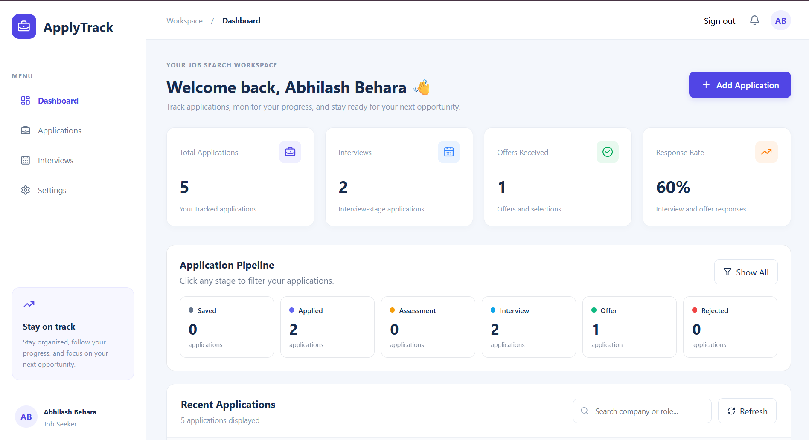

# ApplyTrack — Job Application Tracker

ApplyTrack is a full-stack job application tracking platform designed to help users organize their job search, manage applications, maintain profile information, and upload resumes.

## 🚀 Live Demo

[Open ApplyTrack](https://main.d3uomahh7oyjyy.amplifyapp.com)

## ✨ Features

- User authentication with Amazon Cognito
- Personal profile management
- Job application tracking and organization
- Resume uploads using Amazon S3 presigned URLs
- Serverless backend APIs powered by AWS Lambda
- Data storage with Amazon DynamoDB
- Responsive React-based dashboard
- Chrome extension integration

## 🛠️ Tech Stack

**Frontend:** React.js, JavaScript  
**Authentication:** Amazon Cognito  
**Backend:** AWS Lambda, Lambda Function URLs  
**Database:** Amazon DynamoDB  
**File Storage:** Amazon S3  
**Hosting & Deployment:** AWS Amplify  
**Browser Extension:** Chrome Extension APIs  
**Version Control:** Git, GitHub

## 🏗️ Architecture

- AWS Amplify hosts the frontend application.
- Amazon Cognito handles user authentication.
- AWS Lambda provides backend API functionality.
- Amazon DynamoDB stores application and profile data.
- Amazon S3 stores uploaded resume files.

## 🔐 Security

ApplyTrack uses Cognito-based authentication and authenticated API requests. Resume uploads use S3 presigned URLs.

## 👨‍💻 Developer

**Abhilash Behara**

- GitHub: [Abhilash-jh](https://github.com/Abhilash-jh)
- Portfolio: [abhilashbehara.netlify.app](https://abhilashbehara.netlify.app)
- LinkedIn: [Behara Sai Abhilash](https://www.linkedin.com/in/behara-sai-abhilash-1457982a2)

---

Built as a full-stack project to explore serverless application development with AWS. 
